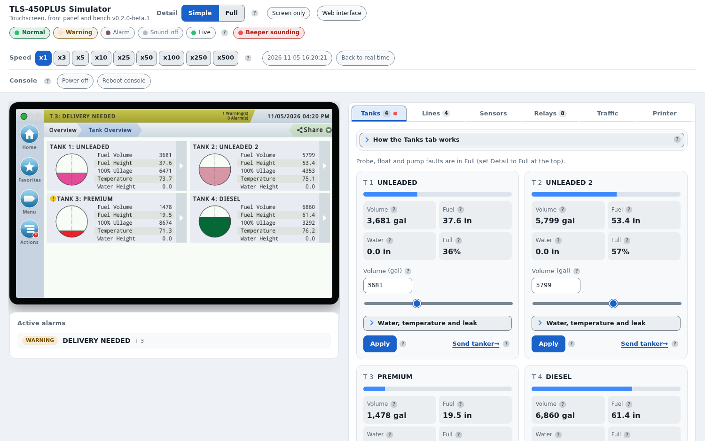
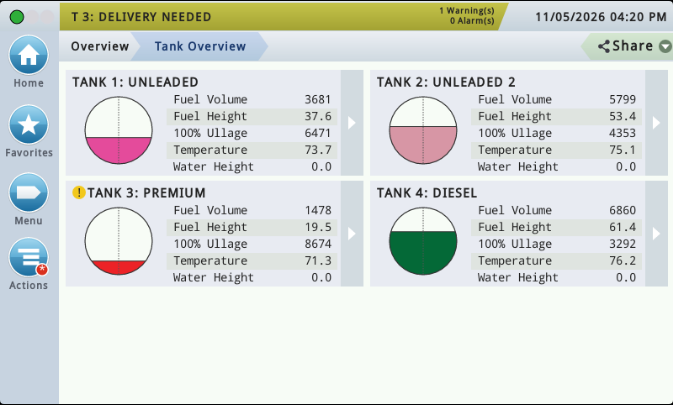
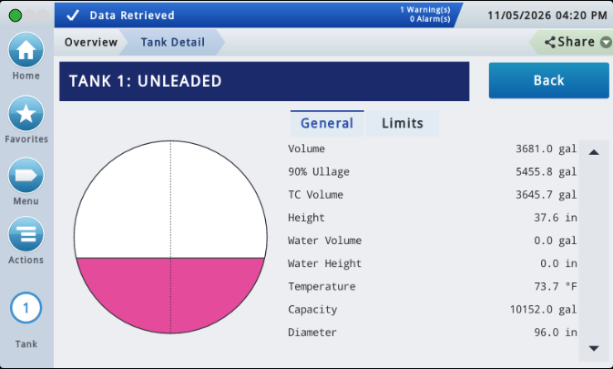
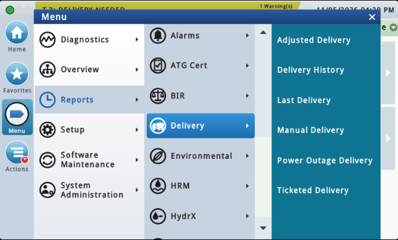

# TLS-450PLUS Simulator

A training simulator for TLS-450PLUS tank monitoring consoles, for Windows.
Practise on the console's touchscreen, set up sites, raise alarms and run
reports, without a console on the bench.

> **Beta software.** This is an early release. Some screens and features are
> not built yet and show a notice instead, and some behaviour may differ from
> a real console. Do not rely on it for anything that matters on a real site.

> **Not a Gilbarco Veeder-Root product.** This is an independent program. It
> is not made, approved, supported or endorsed by Gilbarco Veeder-Root,
> Veeder-Root or Vontier Corporation.

## What it does

| | |
| --- | --- |
|  | **The touchscreen.** The console's screens, menus, popups and keyboards at the console's own 800 x 480 size. Tanks fill and empty, deliveries arrive, alarms post and clear, and reports fill up over time. |
|  | **Tanks, lines and sensors.** Inventory, deliveries, leak tests, line tests and sensor alarms behave the way the console handles them. |
|  | **Menus and setup.** Find your way round Diagnostics, Overview, Reports, Setup and Software Maintenance as on the console. |

**The instructor's bench.** A panel beside the touchscreen: change tank
levels, send a tanker, raise a sensor or probe alarm, pull the power, speed
the clock up, and watch what the console does. Programming is done on the
touchscreen, as on a real console.

**Your own sites.** Load a console's System Snapshot (`snapshot-*.tar`, or an
unpacked snapshot folder) and the simulator takes on that site's tanks,
products, lines, sensors and settings. Export the simulated site as a snapshot
at any time.

**Serial port.** Off unless you ask for it: start the program with
`--serial 127.0.0.1:10001` and a tool that talks to a console over TCP can
connect to the simulator instead.

**Help.** The touchscreen's Help, written in our own words.

**Updates.** The program checks this page for a newer release and offers to
install it. It never installs anything without your click.

## Requirements

- Windows 10 or 11, 64-bit.
- Microsoft Edge WebView2 Runtime. It is part of Windows 11 and current
  Windows 10; if it is missing, the installer offers Microsoft's download.
- No administrator rights: it installs for the current user only.

## Install

1. Download `TLS450-Simulator-Setup-<version>.exe` from the
   [latest release](../../releases).
2. Run it. Windows may show "Windows protected your PC", because the
   installer is not code-signed yet: click **More info**, then **Run anyway**.
3. Start **TLS-450PLUS Simulator** from the Start menu or the desktop.

Each release also lists the installer's SHA-256 checksum.

To remove it: Settings > Apps > TLS-450PLUS Simulator > Uninstall. Your data
folder (`%APPDATA%\TLS450Simulator`, loaded snapshots and exports) is kept.

## Status and warnings

- **Beta.** Features are added release by release. Expect missing screens,
  rough edges and changes between versions.
- **Training and testing only.** It does not monitor real tanks, lines or
  sensors, and nothing it shows is a reading from real equipment. It is not
  a substitute for a real console or for the manufacturer's documentation.
- **Real consoles.** If you test a tool against the simulator before using it
  on a real console, back up the real console first and check every change on
  the console itself.
- **No warranty.** Use it at your own risk (see `LICENSE`).

## Not affiliated with Gilbarco Veeder-Root

This program is an independent simulator. It is not affiliated with,
authorized by, sponsored by or endorsed by Gilbarco Veeder-Root, Veeder-Root,
Vontier Corporation or any of their affiliates. "Veeder-Root" and
"TLS-450PLUS" are trademarks of their respective owners and appear here only
to say, factually, which console this program simulates. No Gilbarco
Veeder-Root software, artwork or documentation is included.

## Licence

Free to use, including at work and for training others. It is **not open
source**: you may not sell it, modify it, or decompile, disassemble or reverse
engineer it. The full terms are in [`LICENSE`](LICENSE). Third-party
components and their licences are listed in
[`THIRD-PARTY-NOTICES.md`](THIRD-PARTY-NOTICES.md).

The source code is kept private. This repository holds the releases only.

Published by Verbose Software.
